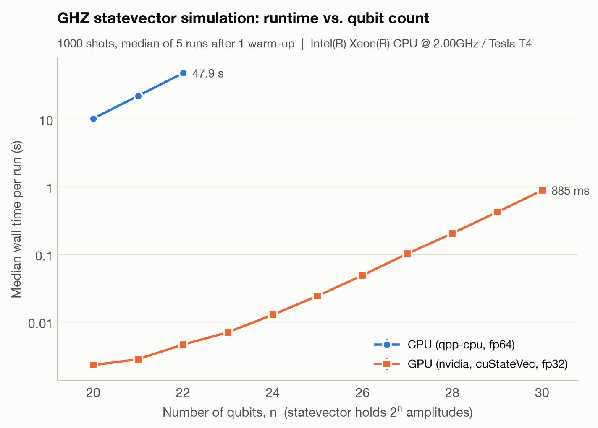
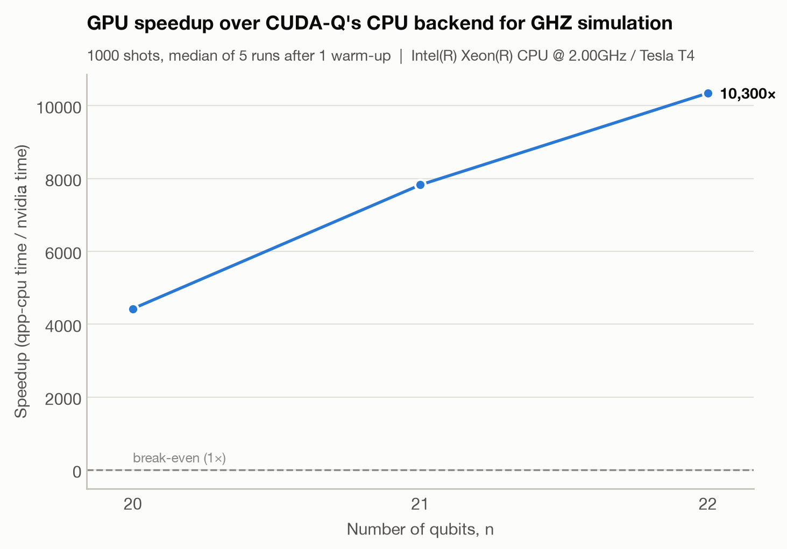
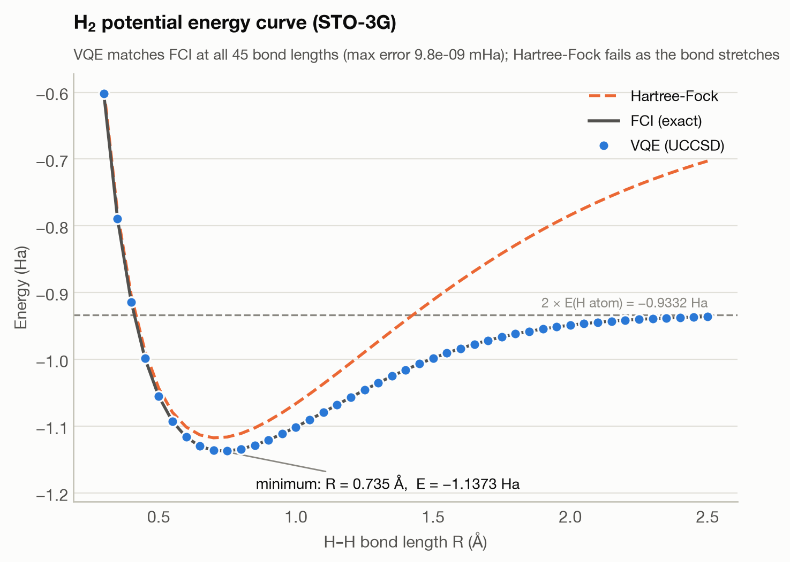
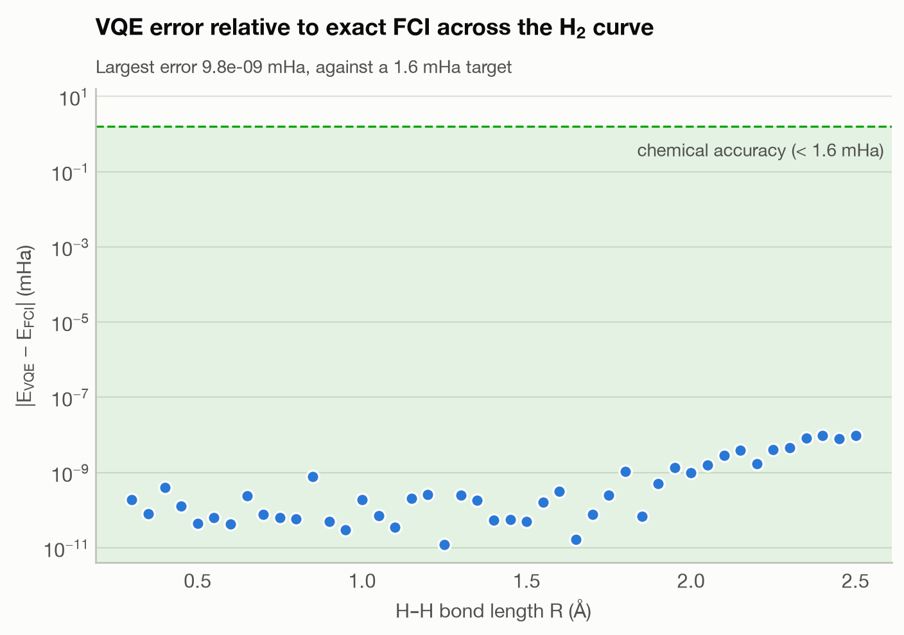
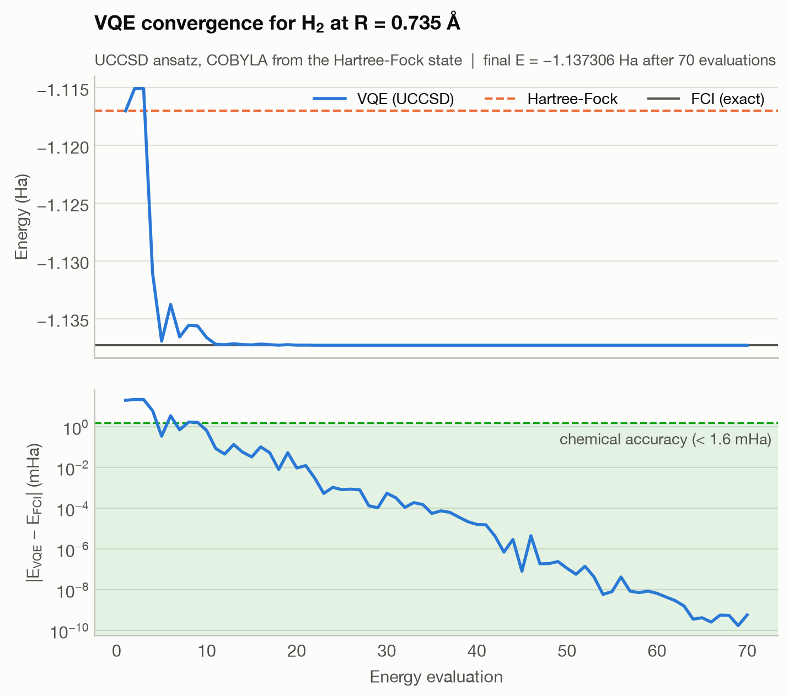
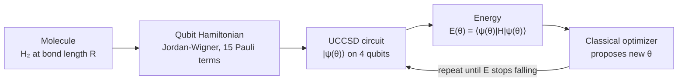

# gpu-quantum-sim

<!-- AUTO:summary:START -->
**gpu-quantum-sim** simulates quantum circuits on classical hardware with [NVIDIA CUDA-Q](https://developer.nvidia.com/cuda-q) and uses that simulator to solve a small quantum-chemistry problem end to end. GHZ circuits were simulated up to **30 qubits** (8 GiB statevector, 884.9 ms per run) on a Tesla T4 GPU (cuStateVec). At 22 qubits, the largest size both backends completed, the GPU was **10,300× faster** than CUDA-Q's `qpp-cpu` backend on the same machine (Intel(R) Xeon(R) CPU @ 2.00GHz, 1 physical core); that baseline is a double-precision reference simulator, so read the factor with the [limitations](#limitations) in mind. A VQE with a UCCSD ansatz reproduces the H₂ potential energy curve at 45 bond lengths with a maximum error of **9.8 × 10⁻⁹ mHa** against exact FCI (chemical accuracy is 1.6 mHa) and finds the equilibrium bond length at **0.735 Å** with E = **−1.1373 Ha**. Every number on this page is generated from the CSV files in [`results/`](results) by [`src/make_readme.py`](src/make_readme.py).
<!-- AUTO:summary:END -->

## Results

### 1. GHZ statevector benchmark: CPU vs. GPU

An n-qubit GHZ state, (|00…0⟩ + |11…1⟩)/√2, is prepared with one Hadamard and a chain of n − 1 CNOTs, then sampled. The circuit is trivial to describe and its output is easy to verify (only two bitstrings may ever appear), yet simulating it still means storing and updating all 2ⁿ amplitudes, which makes it a clean probe of raw simulator throughput.



<!-- AUTO:ghz:START -->


| Qubits | Amplitudes | CPU `qpp-cpu` (fp64) | GPU `nvidia` (fp32) | Speedup |
|---:|---:|---:|---:|---:|
| 20 | 2^20 | 10.19 ± 0.59 s | 2.30 ± 0.08 ms | 4,430× |
| 21 | 2^21 | 22.09 ± 0.61 s | 2.82 ± 0.09 ms | 7,820× |
| 22 | 2^22 | 47.89 ± 0.68 s | 4.63 ± 0.12 ms | 10,300× |
| 23 | 2^23 | — | 7.04 ± 0.06 ms | — |
| 24 | 2^24 | — | 12.79 ± 0.36 ms | — |
| 25 | 2^25 | — | 24.31 ± 0.28 ms | — |
| 26 | 2^26 | — | 49.09 ± 0.05 ms | — |
| 27 | 2^27 | — | 102.49 ± 0.13 ms | — |
| 28 | 2^28 | — | 204.23 ± 0.15 ms | — |
| 29 | 2^29 | — | 422.25 ± 0.30 ms | — |
| 30 | 2^30 | — | 884.88 ± 0.54 ms | — |

Each cell is the median ± standard deviation of 5 timed runs after 1 warm-up, 1000 shots per run, timing the whole `cudaq.sample` call (state allocation, gates and sampling).

Points that were deliberately not run:

- `qpp-cpu`, n = 23–29: at n = 23, projected 623 s for 6 runs exceeds the 600 s per-point time budget.
- `qpp-cpu`, n = 30: statevector needs 16.00 GiB but only 11.20 GiB RAM is free (using at most 80% of it).
<!-- AUTO:ghz:END -->

### 2. H₂ ground-state energy with VQE







<!-- AUTO:vqe:START -->
| Quantity | Result |
|:---|:---|
| Qubits / Pauli terms in the Hamiltonian | 4 / 15 (including the identity) |
| UCCSD parameters | 3 (2 single + 1 double excitation) |
| VQE energy at R = 0.735 Å | −1.137306 Ha after 70 energy evaluations (COBYLA, cold start from Hartree-Fock) |
| FCI energy at R = 0.735 Å | −1.137306 Ha |
| Error at that geometry | 1.7 × 10⁻¹⁰ mHa |
| Bond-length scan | 45 points, 0.30–2.50 Å in 0.05 Å steps, warm-started point to point |
| **Maximum VQE error over the scan** | **9.8 × 10⁻⁹ mHa** at R = 2.50 Å (target: < 1.6 mHa) |
| Maximum Hartree-Fock error over the scan | 233 mHa at R = 2.50 Å |
| **Equilibrium bond length (VQE)** | **0.735 Å** |
| **Minimum energy (VQE)** | **−1.1373 Ha** |
<!-- AUTO:vqe:END -->

Hartree-Fock describes each electron in the average field of the other and cannot represent the two electrons avoiding each other. That error is small near equilibrium and grows as the bond stretches, which is why the dashed curve peels away from the exact one. VQE with UCCSD recovers the missing correlation energy at every geometry.

## Why this is hard

**Memory grows as 2ⁿ.** An n-qubit state is a vector of 2ⁿ complex amplitudes. Each one takes 16 bytes in double precision (8 in single), so every added qubit doubles the memory:

| Qubits | Amplitudes | Double precision | Single precision |
|---:|---:|---:|---:|
| 20 | ~1 million | 16 MiB | 8 MiB |
| 30 | ~1 billion | 16 GiB | 8 GiB |
| 40 | ~1 trillion | 16 TiB | 8 TiB |
| 50 | ~10¹⁵ | 16 PiB | 8 PiB |

**Every gate touches every amplitude.** A gate on one qubit pairs up all 2ⁿ amplitudes and applies the same 2 × 2 matrix to each pair. There is no way to update "just that qubit": one gate on a 30-qubit register is a pass over a billion numbers. A circuit with thousands of gates is thousands of such passes.

**Why a GPU helps, and where it stops.** Those passes are the same tiny operation applied to millions of independent pairs, which is exactly the workload GPUs are built for; NVIDIA's cuStateVec library (the engine behind CUDA-Q's `nvidia` target) runs them across thousands of cores at high memory bandwidth. But a GPU buys *speed*, not *qubits*: the 2ⁿ memory wall is unchanged, so a 16 GB card tops out at 30 qubits in single precision. That is why this benchmark estimates memory before every run and skips sizes that do not fit instead of crashing.

## How VQE works

The variational quantum eigensolver finds a molecule's ground-state energy by letting a classical optimizer tune a parameterised quantum circuit.



1. **Molecule → Hamiltonian.** PySCF computes the electron integrals of H₂ in the minimal STO-3G basis: 2 spatial orbitals, hence 4 spin-orbitals.
2. **Jordan-Wigner mapping.** Each spin-orbital becomes one qubit (|1⟩ = occupied), and the fermionic Hamiltonian becomes a weighted sum of 15 Pauli strings on 4 qubits, such as `ZZII` and `XXYY`.
3. **UCCSD ansatz.** Starting from the Hartree-Fock state |1100⟩ (both electrons in the lowest orbital), the circuit applies parameterised single and double excitations that move electrons into the higher orbital. H₂ needs 3 parameters.
4. **Optimizer loop.** `cudaq.observe` evaluates the energy for the current parameters; SciPy's COBYLA proposes better ones. By the variational principle the energy can never go below the true ground state, so lower is always better.

Along the bond-length scan each geometry is warm-started from its neighbour's optimal parameters, and the result is checked against two independent PySCF calculations: Hartree-Fock (the starting point) and full configuration interaction (FCI, the exact answer in this basis).

## Hardware used

<!-- AUTO:hardware:START -->
- **CPU:** Intel(R) Xeon(R) CPU @ 2.00GHz (1 physical core), 13 GiB RAM
- **GPU:** Tesla T4 (15 GiB VRAM)
- **OS:** Linux 6.6.159+ (x86_64)
- **Software:** CUDA-Q 0.16.0, Python 3.13.16
- **Benchmark run:** 2026-11-14 (UTC)
<!-- AUTO:hardware:END -->

Hardware is detected at runtime. If CUDA-Q reports no NVIDIA GPU, the CPU half still runs, the GPU half is skipped with a clear message, and every other artifact is still produced.

## Reproduce

Requires Python 3.11 or newer (a CUDA-Q 0.16 requirement; developed on 3.12). All versions are pinned in [`requirements.txt`](requirements.txt).

```bash
git clone https://github.com/gracinting/gpu-quantum-sim.git
cd gpu-quantum-sim

make all      # venv + pinned deps, tests, both experiments, plots, README numbers
make quick    # reduced versions of both experiments, about a minute on a laptop CPU
```

Individual steps:

```bash
make install                               # create .venv and install pinned dependencies
make test                                  # pytest
python src/ghz_benchmark.py --max-qubits 30   # CSV + runtime/speedup plots
python src/h2_vqe.py                          # CSV + PES/error/convergence plots
make plots                                 # redraw every plot from the saved CSV/JSON
make readme                                # regenerate the numbers on this page
```

Both scripts accept `--quick`, `--plot-only`, `--out-dir` and `--help`. Quick runs write to `results/quick/` so they never overwrite the committed results.

**On a GPU (free Colab T4):** open [`notebooks/colab_quickstart.ipynb`](notebooks/colab_quickstart.ipynb) in Colab, select a T4 GPU runtime and run all cells. The notebook contains no logic of its own: it installs the pinned dependencies, calls the same scripts, regenerates this README from the new CSVs and offers the results as a download.

## Repository layout

```
src/
  ghz_benchmark.py   GHZ kernel, correctness check, CPU/GPU benchmark, plots, CLI
  h2_vqe.py          H₂ Hamiltonian, UCCSD ansatz, VQE, bond-length scan, plots, CLI
  hardware.py        GPU/RAM/VRAM detection and the statevector memory estimator
  plotting.py        shared figure style
  make_readme.py     fills this README's numbers from results/
tests/               pytest suite (GHZ correctness, memory estimator, 15 Pauli terms,
                     VQE within chemical accuracy, guards, CSV round trips, README sync)
notebooks/           colab_quickstart.ipynb for the GPU run
results/             committed CSV, JSON and PNG outputs of the full run
```

## Design notes

- **API checked against the installed release, not memory.** The code targets CUDA-Q 0.16.0 as inspected at build time. For example, `cudaq.vqe` has been removed in this release, so the optimizer loop is written explicitly around `cudaq.observe`; and requesting the `nvidia` target on a CPU-only install raises an error, so GPU detection runs before any target is selected.
- **Two guards on every benchmark point.** A memory estimate (2ⁿ × 8 or 16 bytes, using the precision the active target reports) is checked against free RAM or VRAM, and the projected wall time is checked against a per-point budget (`--time-budget`, default 600 s). Skipped points are logged with the reason and recorded in `results/ghz_benchmark_meta.json`.
- **Every benchmarked size is also verified.** The warm-up run at each n must return only the all-zeros and all-ones bitstrings, so a timing is never reported for a wrong answer.
- **Independent references.** FCI and Hartree-Fock energies come directly from PySCF, not from the qubit Hamiltonian being tested. A test also builds the Hamiltonian through a second route (OpenFermion → `cudaq.SpinOperator`) and requires both to agree.

## Limitations

- **This is classical simulation.** No quantum hardware is involved, and the simulated qubits are ideal: no gate noise, no decoherence. The VQE energies are exact expectation values rather than estimates from a finite number of measurements, so the shot noise that dominates VQE on real devices is absent.
- **H₂ is small enough to solve exactly.** Its 4-qubit Hamiltonian is a 16 × 16 matrix that a laptop diagonalises instantly, and for two electrons UCCSD spans the full space, so matching FCI is the *expected* outcome. The residual error measures optimizer convergence, not the quality of the ansatz. The value here is a validated pipeline, not new chemistry; larger molecules, where UCCSD is approximate and the simulator cost matters, are the natural next step.
- **The speedup is against a weak baseline, on one machine.** It compares cuStateVec on the GPU with CUDA-Q's own `qpp-cpu` backend on the CPU of the same machine (see [Hardware used](#hardware-used)). `qpp-cpu` is a general-purpose reference simulator running in double precision, while the `nvidia` target runs in single precision, and a free Colab VM provides a single slow physical core. A performance-tuned, multi-threaded CPU simulator on a workstation would narrow the gap substantially. Read the factor as "CUDA-Q's GPU backend vs. its default CPU backend on this VM", not as "GPU vs. the best a CPU can do".
- **GHZ is a shallow circuit.** With only n gates, the measured time includes fixed costs (state allocation, sampling) that deeper circuits would amortise, so the speedup shown is specific to this workload.
- **Pinned to one CUDA-Q release.** CUDA-Q 0.16 announces upcoming changes to `cudaq.sample` and `cudaq.observe`; newer releases may need small updates.

## Résumé bullet

<!-- AUTO:resume:START -->
> GPU-accelerated statevector simulation up to 30 qubits with NVIDIA CUDA-Q/cuStateVec (10,300× speedup over CUDA-Q's CPU backend at 22 qubits on a Tesla T4); VQE with a UCCSD ansatz reproduces the H₂ potential energy curve within 9.8 × 10⁻⁹ mHa of FCI (chemical accuracy).
<!-- AUTO:resume:END -->
